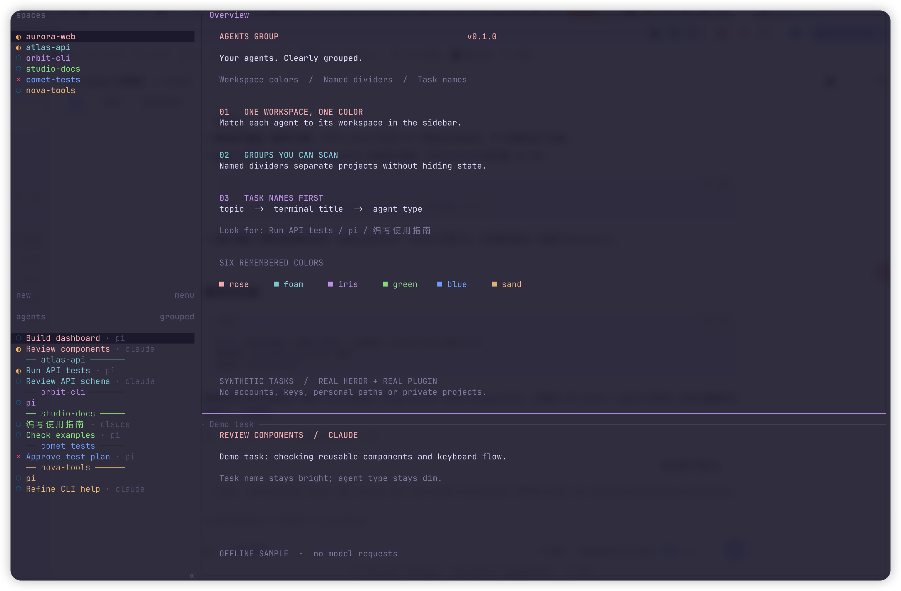

# herdr-agents-group

<p align="center">
  <a href="README.md">English</a> · <strong>简体中文</strong>
</p>

<p align="center">
  <a href="https://herdr.dev">herdr.dev</a> · <a href="#安装">安装</a> · <a href="docs/README.md">文档</a> · <a href="docs/design.md">设计</a>
</p>

---



*真实 Herdr 与插件效果；项目和任务均为演示数据，未调用模型。*

**一眼看清每个 agent 属于哪个 workspace。**

一个 [Herdr](https://github.com/herdrdev/herdr) 侧栏插件。让 workspace 标签与其中的 agent 使用相同配色，并在 workspace 组之间添加带名称的分割线。只改变显示，不改变 agent 执行、焦点或 workspace 归属。

- **一个 workspace，一种归属色** — 六个可记忆的颜色槽，由 workspace 标签与 agent 名称共享。关闭 workspace 会释放其槽位；六种颜色都在使用时，新 workspace 复用使用次数最少的颜色。
- **组间边界带名称** — 在上一组最后一个 agent 下方，以变暗的分割线标出下一组 workspace 的名称。跳过空组。
- **优先显示任务名** — 依次使用 `topic` token、清理后的终端标题、agent 类型。移除多余的目录后缀；当 agent 类型与显示名不同时，以暗色补充类型。
- **随 workspace 变化刷新** — 启动及 workspace、tab、pane、agent 状态、worktree 事件触发侧栏同步。只写入有变化的 `ag_` token。
- **布局由你决定** — 安装插件不会自动安装侧栏布局。单独的 action 才会写入带标记的配置块，并提供备份与冲突保护。
- **仅用标准库** — 无第三方 Python 运行时依赖，不修改 Herdr 源码，也不包装 agent 启动命令。

---

## 安装

运行要求：

- **Herdr 0.9.5 或更新版本**；这是插件清单声明的最低版本，不代表已测试所有后续版本。
- **`/usr/bin/python3` 必须存在，且版本为 Python 3.9+**。所有事件和 action 都使用这一绝对路径；只有 `PATH` 中的其他 `python3` 不够。安装前请检查：

  ```bash
  /usr/bin/python3 --version
  herdr --version
  ```

- 清单声明支持 **macOS 和 Linux**。现有本地单元测试在 macOS 上运行过；Linux 运行时集成尚未验证。清单不支持 Windows。
- 必须能通过 Herdr 注入的 `HERDR_BIN_PATH` 或 `PATH` 找到 Herdr CLI。

从 GitHub 安装：

```bash
herdr plugin install Tomcao1013/herdr-agents-group
```

也可以在本地仓库根目录链接插件：

```bash
herdr plugin link "$PWD" --enabled
```

然后在目标 Herdr session 中，显式安装侧栏布局：

```bash
herdr plugin action invoke install-layout --plugin herdr-agents-group
```

此 action 会修改 `config.toml`、重新加载 Herdr 配置并同步侧栏；如果带标记的配置块已是最新，则只会提示已是最新，不重新加载也不同步。仅安装插件只会注册插件及其 token 更新逻辑；自定义侧栏行需要额外执行此 action。请在 Herdr 插件日志中确认 action 已完成，不要仅凭命令已发出就认定布局安装成功。

### 配置安全

布局 action 优先使用 `HERDR_CONFIG_PATH`，未设置时使用 `~/.config/herdr/config.toml`。配置文件的父目录必须已存在且可写。

- 修改已有文件前，会在同目录创建 `config.toml.bak-agents-group-YYYYMMDD-HHMMSS` 备份，再以原子替换方式写入配置；自定义文件名会使用相应的备份前缀。
- 插件只管理 `# >>> herdr-agents-group >>>` 与 `# <<< herdr-agents-group <<<` 之间的配置块。重新安装会替换整个块，块内的手工修改不会保留。
- 如果块外已有 `[ui.sidebar.agents]` 或 `[ui.sidebar.spaces]`，安装会停止，不会覆盖。请先备份，再手工合并或移除冲突表后重试。缺少结束标记时也需要手工修复。
- 移除布局只会删除带标记的配置块，不会删除其他配置。备份可用于手工恢复，不会自动还原。

颜色分配按 session socket 保存在 `HERDR_PLUGIN_STATE_DIR` 下的 `slots-<hash>.json` 中；未设置该变量时，回退到系统临时目录中的 `herdr-agents-group` 文件夹。状态丢失可能导致重新配色。token 使用 `ag_` 前缀；Herdr 的 token 名称在不同元数据来源之间共享，请将此前缀留给本插件。

多个 session 应使用各自独立且可写的 `HERDR_PLUGIN_STATE_DIR`：颜色文件虽按 socket 区分，但同一目录中的锁与 pending 标记不按 socket 隔离，共用目录可能使不同 session 的事件互相合并。

## 操作

插件启用时可调用：

```bash
herdr plugin action invoke install-layout --plugin herdr-agents-group
herdr plugin action invoke uninstall-layout --plugin herdr-agents-group
herdr plugin action invoke clear --plugin herdr-agents-group
```

- `install-layout` — 安装或替换带标记的布局，重新加载配置并刷新 token；如果带标记的配置块已是最新，则不会重新加载配置，也不会刷新 token。
- `uninstall-layout` — 移除带标记的布局并重新加载配置；实际移除了配置块时，也会清除插件 token。
- `clear` — 清除当前 snapshot 中 pane 和 workspace 上的 `ag_` token，保留其他名称的 token。**不会禁用插件。** 后续事件仍可能重新生成这些 token，即使布局已移除。

### 完整移除

清理完成前，请保留一份完整的插件源码。在连接到待清理 Herdr session 的终端中，**从该插件源码目录**执行：

```bash
herdr plugin disable herdr-agents-group
# 等待已经运行的插件命令结束，再继续。
/usr/bin/python3 main.py uninstall-layout
/usr/bin/python3 main.py clear
herdr plugin uninstall herdr-agents-group
```

顺序很重要：先禁用事件处理，再移除布局、清除 token，最后移除插件安装。Herdr 不允许调用已禁用插件的 action，因此这里刻意直接运行保留的 Python 入口。单独执行 `clear` 也能处理配置块早已不存在的情况。任何清理命令失败，都不要继续下一步。

如果使用本地链接，将最后的卸载命令换成 `herdr plugin unlink herdr-agents-group`。如果使用自定义配置路径，清理时也要保留 `HERDR_CONFIG_PATH`。操作其他 session 时，请设置对应的 `HERDR_SOCKET_PATH`；对曾运行过本插件的其他 session，分别重复 token 清理。以上步骤完成前，不要删除源码目录。

## 限制

- **按 workspace 分组，不按 pane 分组** — 插件只美化 Herdr 现有的 workspace 分组 agent 列表，不创建分组，也不改变排序。
- **priority 排序不显示分割线** — 配置 `agent_panel_sort = "priority"` 时，保留 workspace 配色，但不显示组间分割线。
- **仅处理本地 snapshot** — 不处理合并侧栏中的远程机器 agent。
- **优先适配深色主题** — 固定色板面向深色主题。包括 rose-pine-dawn 在内的浅色主题尚未验证对比度，可能不够清晰。
- **依赖 snapshot 顺序** — 同一 workspace 内的 agent 保持 snapshot 顺序；该顺序与实际侧栏显示一致并非 API 保证。
- **名称随事件刷新，并非即时更新** — 其他插件写入 `topic` 本身不会触发本插件。名称会在下一次订阅事件到来时刷新，包括 agent 状态变化事件。
- **分割线占用第二行** — 第一组上方没有分割线。分割线以 20 个终端列为目标，窄侧栏可能截断。选中、悬停时的渲染及窄宽度表现仍需真实界面验证。

## 文档

[文档索引 →](docs/README.md) · [当前设计与实现边界 →](docs/design.md) · [Herdr 插件文档 →](https://herdr.dev/docs/plugins/)

文档索引区分当前行为与历史提案。当前实现是基于 Herdr 元数据 token 的 Python 插件，不是对 Herdr pane 模型的修改。

## 开发

在仓库根目录使用 Python 3.9+ 运行：

```bash
python3 -m unittest discover -s tests -v
```

测试仅使用标准库，无需运行 Herdr 服务。覆盖颜色分配与状态文件、名称与分割线格式、token 规划与差异、带标记配置块处理、Herdr CLI 输出处理与 action 通知以及事件合并。单元测试不能替代真实侧栏、远程机器或跨平台集成验证。

## 许可证

采用 [MIT 许可证](LICENSE)。
